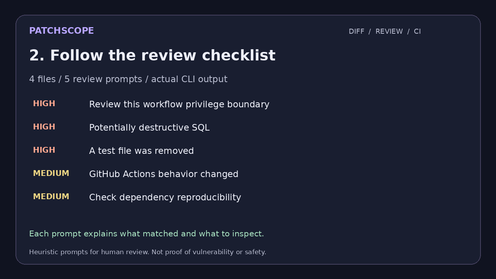

<div align="center">


# PatchScope
### Big diff? Know where to look.

**Turn a Git patch into an actionable review checklist — in your browser, terminal or GitHub Actions.**

[Install from GitHub Marketplace](https://github.com/marketplace/actions/patchscope-diff-review) · [Try the live demo](https://brunnojob.github.io/patchscope/) · [CLI quick start](#cli-quick-start) · [Contribute a rule](CONTRIBUTING.md)

[](https://github.com/marketplace/actions/patchscope-diff-review)

[](https://github.com/brunnojob/patchscope/releases)
[](LICENSE)
[](https://donate.stripe.com/6oU8wQg9k9Hb8809CrfQI01)

</div>


---

Reviewing a change is easier when you know where to start. PatchScope reads a unified diff and highlights concrete reasons to take a closer look: removed tests, broad workflow permissions, destructive SQL, dependency changes and more.

Every prompt explains **what matched, why it matters and what to check next**. The same dependency-free engine powers the web app, CLI and reusable GitHub Action.

**No API keys. No model calls. No code uploads. No account.**

## Watch the workflow

[](https://brunnojob.github.io/patchscope/docs/launch/demo.html)

[Watch the 18-second walkthrough](https://brunnojob.github.io/patchscope/docs/launch/demo.html) · [Download MP4](https://github.com/brunnojob/patchscope/raw/main/docs/launch/patchscope-demo.mp4) · [Follow the practical tutorial](docs/launch/tutorial.md)

Rendered from the actual bundled fixture output. The CI panel illustrates the reporting integration; it is not a GitHub screen recording. [Transcript](docs/launch/transcript.md).

## Try it in 30 seconds

1. Open **[PatchScope](https://brunnojob.github.io/patchscope/)**.
2. Click **Explore the example**, or paste `git diff --no-ext-diff --no-color HEAD` output.
3. Filter prompts, inspect changed lines and export a Markdown checklist for your pull request.

The bundled example has **4 changed files and 5 review prompts**. Also try the skipped-test example or a documentation-only patch with no matched rules.

## From patch to review plan

A release patch changes a workflow, drops a SQL table, removes tests and updates a dependency manifest. PatchScope turns those changes into a prioritized checklist:

```text
4 files · 5 review prompts
HIGH    Review this workflow privilege boundary
HIGH    Potentially destructive SQL
HIGH    A test file was removed
MEDIUM  GitHub Actions behavior changed
MEDIUM  Check dependency reproducibility
```

Each prompt includes its file, a line number when available, the reason it matched and a concrete action. Export the checklist to your PR, then use the diff viewer to inspect the context. Run `npm run demo` to reproduce this example locally.

## Choose your workflow

| Where you review | Start here | Result |
| --- | --- | --- |
| Browser | [Open the workspace](https://brunnojob.github.io/patchscope/) | Interactive file map, filters and checklist |
| Terminal | Pipe `git diff` into the CLI | Markdown, JSON or SARIF on stdout |
| CI | Add the composite Action | Job summary and downloadable reports |
| CI with an explicit threshold | CLI `--fail-on high` | Full report plus exit code `2` for high-priority prompts |

## What it catches

| Signal | Review prompt |
| --- | --- |
| Private-key headers or credential-like literals | Verify values and replace real credentials with secret references |
| `permissions: write-all` or `pull_request_target` | Review the workflow privilege boundary |
| `DROP` or `TRUNCATE` SQL | Confirm environment, backups and recovery |
| Deleted test files | Confirm replacement coverage |
| Skipped or exclusive test markers | Check which tests actually run |
| Known TLS verification bypass patterns | Restore certificate verification |
| Dynamic `eval` / `exec` calls | Trace input and execution context |
| Dependency manifest without a compatible same-directory lockfile in the patch | Check the project’s dependency policy |
| Source changes without changed tests | Confirm existing coverage or add a regression test |
| Binary changes or large file changes | Make space for a separate review |

These are **heuristics, not a security audit**. A match can be intentional; no matches do not establish safety. Dependency and test prompts describe the patch, not the whole repository. There is no invented risk percentage or claim that the tool understands an entire application.

## Browser workspace

Paste or drop a patch, explore files with old/new line numbers, filter severity and check off review actions. Copy Markdown or download Markdown/JSON. `Ctrl+Enter` / `Command+Enter` analyzes; **Clear** removes the patch and results from memory.

Patches stay in page memory. The app uses no localStorage, analytics, third-party fonts or remote processing. Reports contain file names, metrics and prompts, **not raw source lines or detected credential values**. File names can themselves be sensitive: inspect reports before sharing. GitHub Pages applies its own infrastructure privacy policies.

Limits: **2 MB, 500 file sections and 60,000 input lines**. The file preview displays at most 1,500 lines; the engine analyzes all supported lines within those limits.

## CLI quick start

Requires Node.js 22+. No `npm install` needed.

```sh
git clone https://github.com/brunnojob/patchscope.git
cd patchscope
npm run demo
node scripts/cli.mjs docs/example.diff --format json
```

Review your own patch:

```sh
git diff --no-ext-diff --no-color HEAD > change.diff
node /path/to/patchscope/scripts/cli.mjs change.diff --format markdown > review.md
```

Or use stdin:

```sh
git diff --no-ext-diff --no-color HEAD | node /path/to/patchscope/scripts/cli.mjs - --format json
```

By default, findings do not fail the command. For a review workflow that needs an explicit priority threshold:

```sh
node scripts/cli.mjs change.diff --format json --fail-on high > review.json
```

The full report is still written to stdout. `high` matches high-priority prompts; `medium` includes high and medium; `info` includes every prompt. Treat a threshold match as a request for human review, not proof of a vulnerability.

| Exit code | Meaning |
| --- | --- |
| `0` | Analysis completed and no requested threshold matched |
| `1` | Invalid options, missing file, malformed or oversized input |
| `2` | A prompt met the explicitly requested `--fail-on` threshold |

Use `--help` for options. Without `--fail-on`, analysis exits `0` even when prompts are found.

## Configure rules and explain exceptions

Pass an explicit JSON file with `--config`; PatchScope never discovers or executes repository configuration automatically. This config customizes the built-in rules, not arbitrary executable plugins.

```json
{
  "rules": {
    "large-file": "info",
    "test-coverage": "off"
  },
  "suppressions": [
    {
      "rule": "destructive-sql",
      "path": "src/db/migrate.sql",
      "line": 1,
      "reason": "Disposable fixture database; reviewed in issue 42."
    }
  ]
}
```

```sh
node scripts/cli.mjs change.diff --config patchscope.json --format json
node scripts/cli.mjs change.diff --config patchscope.json --format sarif > review.sarif
```

Rule settings accept `high`, `medium`, `info` or `off`. Omitted rules keep their defaults. Unknown keys, rules, severities and invalid suppressions fail explicitly. Configuration files are limited to 256 KB and 1,000 suppressions.

Suppressions match an **exact rule and patch path**, with an optional positive new-line number. Omit `line` to cover that rule throughout the named file, including file-level prompts. Paths are case-sensitive, use `/`, and have no glob syntax. Each suppression requires a reason of up to 500 characters. Only the first matching suppression applies; unmatched entries have no effect.

Suppressed prompts stay in JSON (`suppressed`), Markdown and SARIF with their justification. They do not contribute to active counts or `--fail-on`. Rules set to `off` do not emit prompts; disabled rule IDs are disclosed in report metadata and Markdown. Severity overrides apply before thresholds. Keep reasons free of credentials or private source: supplied justifications are exported verbatim in JSON/SARIF and escaped in Markdown.

Available rule IDs: `binary`, `deleted-tests`, `environment`, `large-file`, `workflow`, `private-key`, `credential`, `destructive-sql`, `test-scope`, `workflow-privilege`, `tls`, `dynamic-code`, `lockfile`, `test-coverage`.

The engine API accepts the same object: `analyzeDiff(patch, config)`. The browser workspace uses the default rules; configuration is currently exposed through the CLI, engine API and Action.

## SARIF export

`--format sarif` produces SARIF 2.1.0 with rule IDs, encoded file paths, new-line locations when available and priorities mapped to `error` / `warning` / `note`. File-level prompts have no invented line number. Explained exceptions use external suppressions. Raw diff lines and detected credential values are not included.

The Action also writes a SARIF report. Export is local: publishing a report to a code-scanning service is a separate workflow step with that service's permissions and availability requirements. SARIF priorities still describe heuristic review prompts, not confirmed vulnerabilities.

## GitHub Actions

Install **[PatchScope diff review](https://github.com/marketplace/actions/patchscope-diff-review)** from GitHub Marketplace, or save the workflow below as `.github/workflows/patchscope.yml`. The Action is free and MIT licensed. No registration, subscription or donation is required.

The example compares the PR merge base with its head, so it reviews the proposed changes. It runs with read-only repository permissions and does not execute PR source code. Keep this event as `pull_request`, including for contributions from forks.

The composite action accepts an existing patch, writes a job summary and creates Markdown, JSON and SARIF report files. It does not post comments, request an API token, contact an AI service or modify the repository.

```yaml
name: Patch review
on: pull_request
permissions:
  contents: read
jobs:
  review:
    runs-on: ubuntu-latest
    steps:
      - uses: actions/checkout@v4
        with:
          fetch-depth: 0
          persist-credentials: false
      - name: Create review patch
        shell: bash
        env:
          BASE_SHA: ${{ github.event.pull_request.base.sha }}
          HEAD_SHA: ${{ github.event.pull_request.head.sha }}
        run: git diff --no-ext-diff --no-color "$BASE_SHA...$HEAD_SHA" > review.diff
      - uses: brunnojob/patchscope@v2.0.1
        id: scope
        with:
          diff-file: review.diff
      - uses: actions/upload-artifact@v4
        with:
          name: patchscope-review
          path: |
            ${{ steps.scope.outputs.report-json }}
            ${{ steps.scope.outputs.report-markdown }}
            ${{ steps.scope.outputs.report-sarif }}
```

Use the versioned release above for a reproducible starting point. For stronger supply-chain protection in production, pin this and other third-party actions to reviewed full commit SHAs. The composite action declares `actions/setup-node@v4` to provide Node.js 22.

| Input / output | Meaning |
| --- | --- |
| `diff-file` | Required path to an existing unified diff |
| `config-file` | Optional explicit JSON configuration path; no auto-discovery |
| `summary` | `true` by default; `false` disables the job summary |
| `report-json` | Output path to the JSON report |
| `report-markdown` | Output path to the Markdown report |
| `report-sarif` | Output path to the SARIF 2.1.0 report |
| `suppressed-count` | Number of prompts with explained suppressions |
| `high-count` | Output count of high-priority heuristic prompts |

Add `config-file: patchscope.json` under the Action’s `with:` block to apply a reviewed policy. On pull requests, choose a trusted policy file if these settings influence your review decisions. The Action reports active counts and remains non-blocking; CLI thresholds are opt-in.

For troubleshooting and the complete input/output contract, see [the Action guide](docs/github-action.md). Report bugs through [GitHub Issues](https://github.com/brunnojob/patchscope/issues). For sensitive reports, see [SECURITY.md](SECURITY.md).

Action summaries and artifacts follow your repository’s access and retention settings. Browser code is not uploaded; your configured workflow can publish its report.

## Why this exists

PatchScope is a small review tool you can inspect, run locally and adapt without an account, backend or model subscription. It helps prepare the human review instead of assigning an opaque score.

If it saves you review time, **[a star helps others find it](https://github.com/brunnojob/patchscope)**. A reproducible edge case or carefully scoped rule is just as useful.

## Development

```sh
npm run dev
npm run check
npm test
```

Open `http://localhost:4173`. ES modules need HTTP; opening the HTML with `file://` is unsupported.

| Module | Responsibility |
| --- | --- |
| `src/engine.js` | Diff parsing, heuristics and Markdown generation |
| `src/config.js` | Built-in rule settings, validation and explained suppressions |
| `src/sarif.js` | SARIF 2.1.0 export |
| `src/app.js` | Browser interactions and downloads |
| `src/examples.js` | Synthetic offline examples |
| `scripts/cli.mjs` | File/stdin CLI |
| `scripts/action.mjs` | Job summary and report outputs |
| `action.yml` | Reusable composite action |
| `tests/` | Parser, rules, report privacy, CLI and Action integration |

Tests cover quoted/UTF-8 names, renames, line numbers, binary changes, deleted tests, placeholder credentials, escaping, limits, stdin and actual output files. CI runs on Linux/Windows with Node.js 22/24 and smoke-tests the composite action.

## Dependency checks in monorepos

A lockfile only suppresses a manifest prompt when it belongs to a compatible ecosystem and is in the same directory. Changing `apps/api/package-lock.json` does not hide a prompt for `apps/web/package.json`; changing `go.sum` does not cover an npm manifest. npm shrinkwrap, pnpm, Yarn and Bun lockfile names are recognized alongside the existing Python, Go, Rust and Ruby formats.

Shared workspace lockfiles can live above a package. PatchScope does not read workspace configuration or unchanged files, so it keeps the prompt and asks you to confirm the workspace policy. A prompt does not mean a lockfile is missing from your repository.

## Limits and next steps

Recognizes unified text diffs and basic Git file metadata. Combined merge diffs, AST analysis, full secret scanning and whole-repository context are outside this version. Comments, multiline constructs, unusual languages and test-file naming conventions can produce false negatives. Binary content is not inspected.

Next steps: additional parser fixtures, richer workspace-aware dependency checks and browser controls for configuration. Rule settings, explained suppressions and SARIF export are implemented in the engine, CLI and Action.

## Share and teach

Use the [launch resources](docs/launch/README.md) for a reproducible demo, copyable workflow, DEV.to tutorial, LinkedIn post, Show HN draft and Awesome Actions proposal. These materials focus on real behavior and documented limits.

## Support PatchScope

Keep local-first code review accessible to everyone. Contributions help fund maintenance, regression fixtures, documentation and new review rules. Choose your contribution amount on Stripe; support is optional and unlocks no required features.

<p align="center">
  <a href="https://donate.stripe.com/6oU8wQg9k9Hb8809CrfQI01">
    
  </a>
</p>

[Contribute via Stripe](https://donate.stripe.com/6oU8wQg9k9Hb8809CrfQI01) · [Buy Me a Coffee](https://buymeacoffee.com/brunnodev) · [Contribute code or fixtures](CONTRIBUTING.md)

The contribution button opens Stripe checkout on Stripe’s website. PatchScope does not collect payment details.

## Credits and license

Created by **[brunnodev](https://brunnodev.store)** on **[brunnojob](https://github.com/brunnojob)**. MIT licensed; see [LICENSE](LICENSE).
